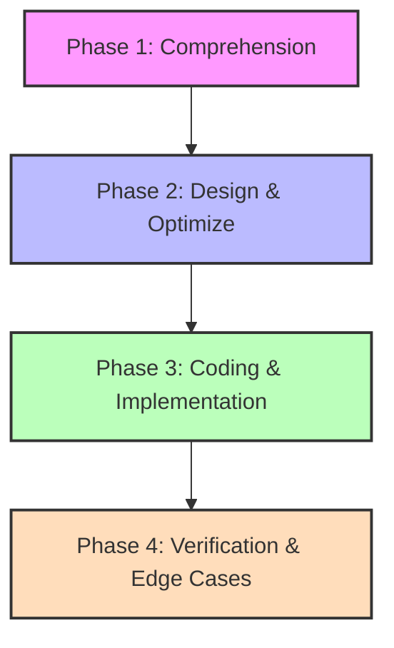

# 🚀 LeetCode & Coding Interview Execution Guide

This guide outlines a step-by-step approach to tackling coding challenges during personal practice and live interviews.

---

## 🗺️ The Four-Phase Execution Framework



### 1. Phase 1: Comprehension & Clarification (0–5 Mins)
> [!IMPORTANT]
> Do not write any code in this phase. The goal is to fully understand constraints and expectations.

*   **Read & Restate:** Read the problem statement twice. Restate it in your own words to verify your understanding.
*   **Identify Constraints:** Look at the size limits (e.g., $N \le 10^5$). This tells you whether an $O(N^2)$ algorithm will timeout (TLE).
*   **Create Dry Run Examples:** Walk through the provided test cases. Draw one or two of your own (especially a minimal edge case like an empty array or a single element).

### 2. Phase 2: Design & Optimization (5–15 Mins)
> [!TIP]
> Propose the brute force first, then use pattern recognition to optimize before writing code.

*   **Draft the Brute Force:** State the simplest solution first and analyze its complexity (e.g., *"The naive solution is a nested loop taking $O(N^2)$ time and $O(1)$ space."*).
*   **Match the Pattern:** Check the input structure for optimization cues:
    
    | If you see... | Try this pattern... | C# Collections / API |
    | :--- | :--- | :--- |
    | Sorted array / search target | Two Pointers or Binary Search | `left = 0; right = len - 1;` |
    | Contiguous subarray or window | Sliding Window | `Queue<T>` or double pointers |
    | Frequency counts / fast lookups | Hash Map or Hash Set | `Dictionary<K, V>` or `HashSet<T>` |
    | Dynamic min/max, K-th elements | Min/Max Heap | `PriorityQueue<TElement, TPriority>` |
    | Node relationships / dependencies | BFS / DFS or Topological Sort | Recursion or `Queue<T>` |

*   **State Optimized Complexity:** Clearly state the target Time and Space complexity *before* writing code.

### 3. Phase 3: Coding (15–30 Mins)
> [!NOTE]
> Write clean, modular, production-ready code.

*   **Guard Clauses First:** Handle nulls, empty inputs, and out-of-bound edge cases at the top of your function.
    ```csharp
    if (nums == null || nums.Length == 0) 
        return 0; 
    ```
*   **Use Meaningful Names:** Avoid single-letter variables except for loop indices. Use descriptive names like `left`, `right`, `seen`, and `complement`.
*   **Communicate as you Code:** If in a live interview, speak out loud to explain the purpose of your loops and variables.

### 4. Phase 4: Verification & Edge Cases (30–40 Mins)
> [!CAUTION]
> Never say "I'm done" without manually tracing an example first.

*   **Dry Run Line-by-Line:** Pick a small example (e.g., `input = "aba"`) and trace the execution step-by-step. Keep a written log of variable states as they change.
*   **Check Edge Cases:** Validate behavior with:
    - Empty inputs / Null pointers.
    - Single-element arrays.
    - Negative values / potential integer overflows.
    - Duplicate elements.

---

## 📝 Example Walkthrough: Transaction Deduplication

### The Problem
> *"Given a stream of incoming transactions, identify duplicates. Two transactions are considered duplicates if they have the exact same merchant, amount, and occur within 60 seconds of each other. Return the IDs of the duplicate transactions."*

#### Phase 1: Comprehension & Clarification
*   **Input Data Structure:**
    ```csharp
    public record Transaction(string Id, string Merchant, long Amount, DateTime Timestamp);
    ```
*   **Restated Goal:** We need to scan transactions in chronological order. If a transaction matches another transaction (same merchant & amount) that occurred $\le 60$ seconds ago, flag it as a duplicate.
*   **Clarification Questions (to ask an interviewer):**
    1. *Are transactions sorted by timestamp?* (Assume: Yes, they arrive in chronological order).
    2. *Is the stream infinite?* (Assume: Yes, we need to prevent memory leaks by evicting transaction history older than 60 seconds).
    3. *How should money be represented?* (Assume: Cents/pence as a `long` to avoid floating-point errors).

#### Phase 2: Design & Optimization
*   **Brute Force:** Compare each new transaction to all previous transactions.
    - *Complexity:* Time $O(N^2)$, Space $O(N)$ (we store every transaction).
*   **Optimized Approach (Hash Map + Sliding Window/Eviction):**
    - Group transactions using a composite key: `"{merchant}:{amount}"`.
    - For each group, store the transactions in a `Queue<Transaction>`.
    - When a new transaction arrives:
      1. Evict any transactions from the front of the queue that are older than 60 seconds relative to the new transaction's timestamp (sliding window eviction).
      2. If there are still transactions left in the queue, the new one is a duplicate!
      3. Push the new transaction to the back of the queue.
    - *Complexity:* 
      - Time $O(N)$ (each transaction is enqueued and dequeued at most once).
      - Space $O(W)$ where $W$ is the maximum number of transactions occurring within any rolling 60-second window. This is highly memory-efficient.

#### Phase 3: Coding (C# Implementation)
```csharp
using System;
using System.Collections.Generic;

public class TransactionDeduplicator
{
    // Groups transactions by "merchant:amount" -> queue of recent transactions
    private readonly Dictionary<string, Queue<Transaction>> _recentTransactions = new();
    private const double WindowSeconds = 60.0;

    public List<string> ProcessTransactions(IEnumerable<Transaction> stream)
    {
        var duplicates = new List<string>();
        if (stream == null) return duplicates;

        foreach (var tx in stream)
        {
            if (tx == null) continue;

            string key = $"{tx.Merchant}:{tx.Amount}";

            if (!_recentTransactions.TryGetValue(key, out var queue))
            {
                queue = new Queue<Transaction>();
                _recentTransactions[key] = queue;
            }

            // 1. Evict expired transactions (> 60s old) from the window
            while (queue.Count > 0 && (tx.Timestamp - queue.Peek().Timestamp).TotalSeconds > WindowSeconds)
            {
                queue.Dequeue();
            }

            // 2. If the queue is not empty, any remaining item is a duplicate
            if (queue.Count > 0)
            {
                duplicates.Add(tx.Id);
            }

            // 3. Add the current transaction to the window
            queue.Enqueue(tx);
        }

        return duplicates;
    }
}
```

#### Phase 4: Verification & Edge Cases
*   **Dry Run Simulation:**
    - Incoming Stream:
      1. `Tx1`: Tesco, 1000p, 10:00:00
      2. `Tx2`: Tesco, 1000p, 10:00:45 (45s later)
      3. `Tx3`: Tesco, 1000p, 10:01:50 (65s later than Tx2)
    - **Step 1 (Tx1):** Key = `"Tesco:1000"`. Queue created. Queue is empty. No eviction. No duplicate. Enqueue `Tx1`.
    - **Step 2 (Tx2):** Key = `"Tesco:1000"`. Peak difference is $45$ seconds. No eviction. Queue has `Tx1`, so `Tx2` is flagged as duplicate. Enqueue `Tx2`.
    - **Step 3 (Tx3):** Key = `"Tesco:1000"`. Peek check: `Tx3 - Tx1` is $110$ seconds (evict `Tx1`). Next peek check: `Tx3 - Tx2` is $65$ seconds (evict `Tx2`). Queue is now empty. No duplicate detected. Enqueue `Tx3`.
*   **Result:** `[Tx2]` flagged as duplicate. Correct.

---

## 🏦 Fintech-Specific Performance Checklist

When interviewing at fintech companies like Monzo, keep these backend performance guidelines in mind:

1.  **Minimize Heap Allocations ($O(1)$ Space):**
    - Avoid converting strings to char arrays (`ToCharArray()`) or allocating new strings if you can query the indexer directly.
    - Re-use buffers or arrays if memory allocations are a concern.
2.  **Early Exit Design:**
    - If a condition is failed early on, return immediately rather than waiting for the entire dataset to process.
3.  **Use Safe Types for Money:**
    - Always represent currency values as integers (e.g., cents, pence) rather than floats/doubles to avoid floating-point rounding errors.
